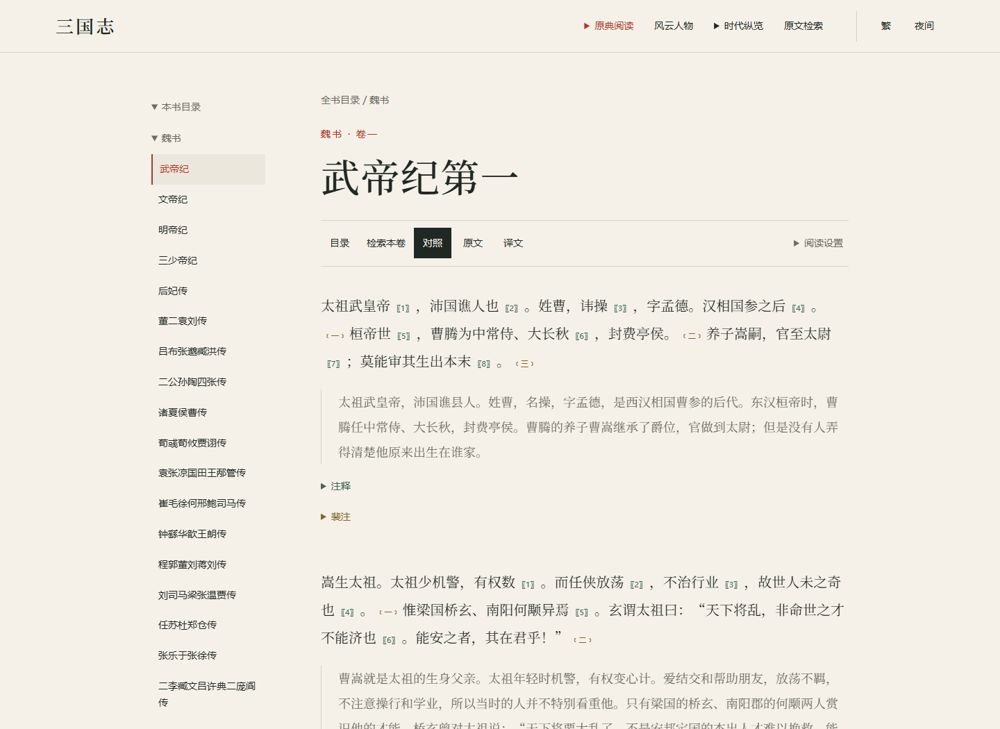
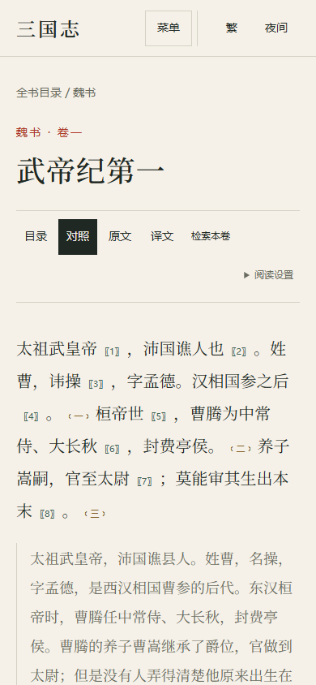

# 三国志

围绕《三国志》原典、人物与史事构建的数字阅读网站。阅读正文与译注，检索篇章中的文字，沿人物经历与时代脉络查阅记载，并返回文献出处。

**[进入网站 →](https://www.hoven.zone/sanguozhi/reader/)**

## 页面预览

### 桌面 · 原典阅读

### 手机 · 原典阅读

## 主要功能

- **原典与译注**：按魏、蜀、吴浏览篇目，切换原文、译文或对照阅读，随文查阅裴注与现代注释。
- **原文检索**：检索全书或指定篇目的原文，支持简繁查询、命中高亮和段落定位。
- **人物经历**：通过风云人物与人物大全查阅人物资料、经历及相关记载，展开引文或进入原文阅读。
- **年表与星图**：沿审定年份浏览大事年表，或通过时代星图探索精选史事，查阅相关人物与文献依据。
- **阅读设置**：调整字号、简繁与明暗主题，适配桌面和手机阅读。

## 文献说明

当前文本采用《三国志译注》，陈寿撰、裴松之注、方北辰译注，上海古籍出版社。正文、裴注与现代译注分层呈现，保留所据文本的标点与分段；简繁转换用于显示与检索。

人物资料与史事关联提供引文和出处。不同记载及年代不确定性分别保留，译文不作为独立史料依据。内容持续整理，当前成果不代表全书逐字人工精校。
